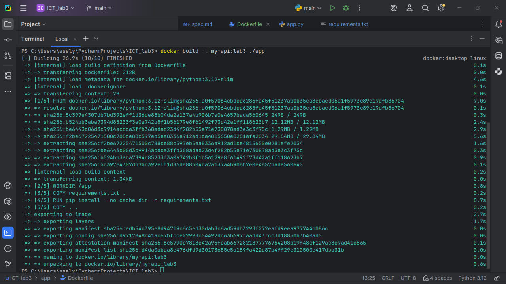
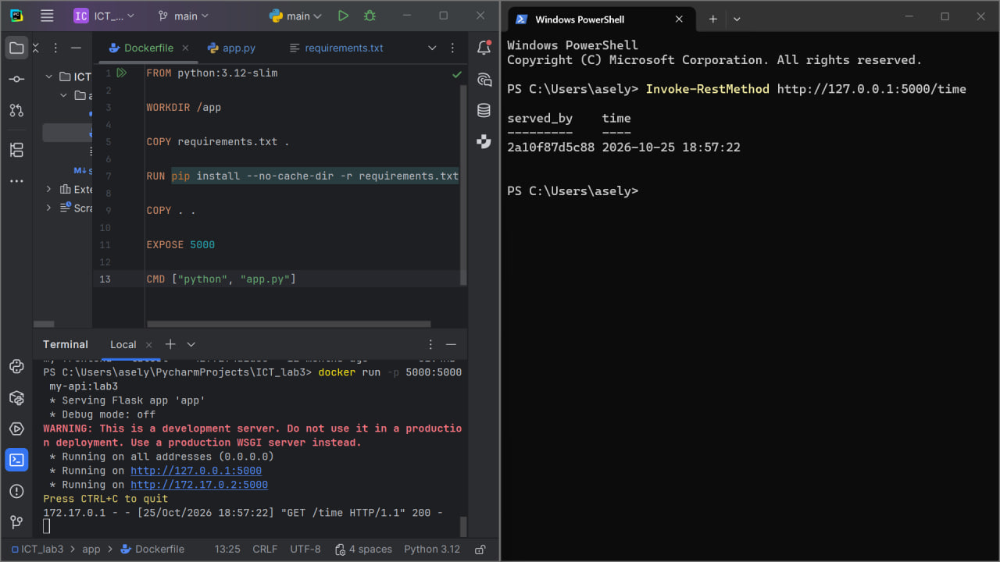
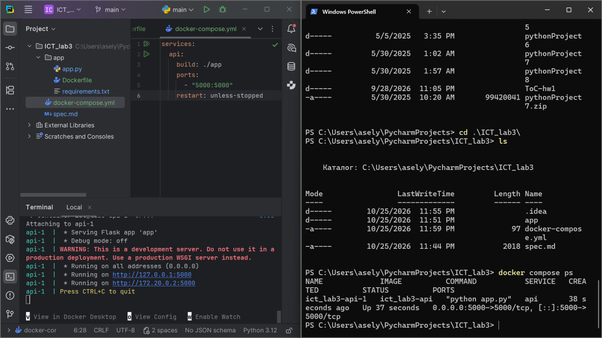
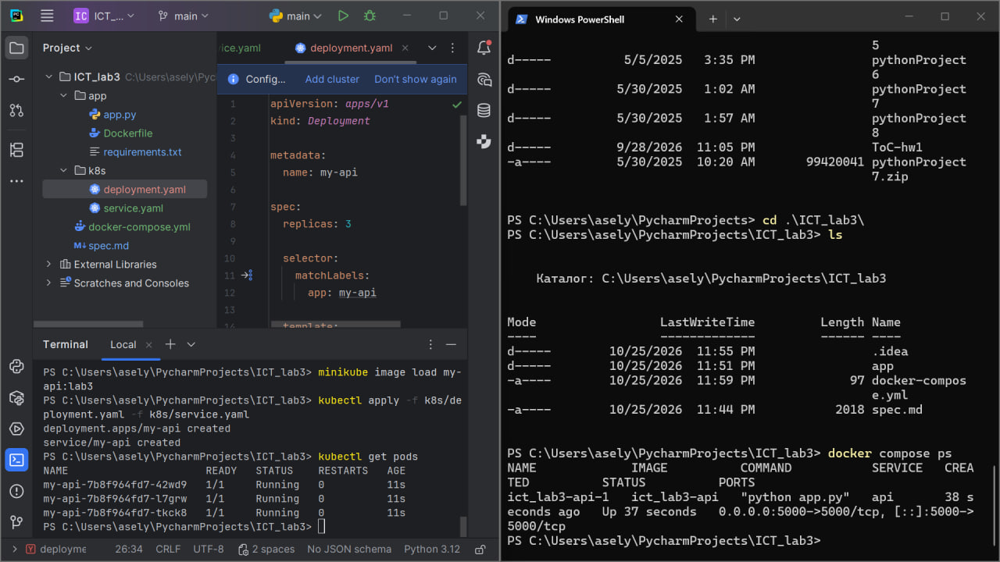
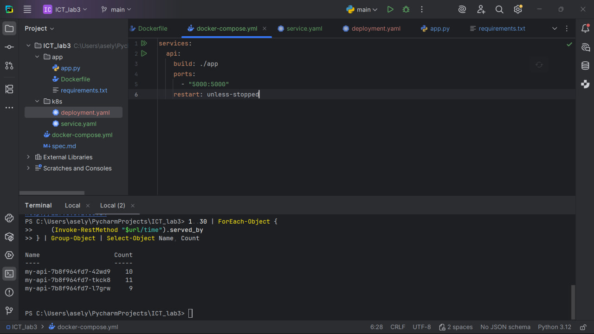
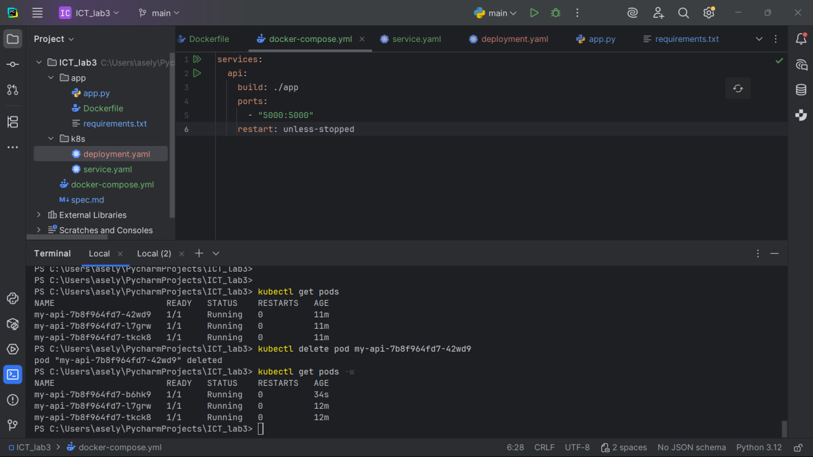
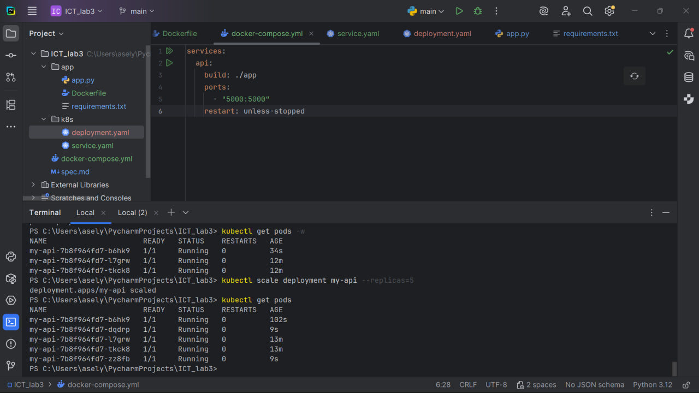

# ICT Lab 3 — Docker and Kubernetes

## Project Description

This project is a continuation of Lab 2.

The Flask REST API was moved into a Docker container and then deployed to Kubernetes.

The main goals of this lab were:

- build and run a Docker container;
- use Docker Compose;
- deploy the application to Kubernetes;
- run 3 copies of the application;
- show request distribution between pods;
- demonstrate self-healing;
- demonstrate scaling.

The API has two main endpoints:

- `POST /echo` — returns the same message;
- `GET /time` — returns the current time and the name of the pod or container that answered.

Example:

```json
{
  "time": "2026-10-25 23:50:00",
  "served_by": "2a10f87d5c88"
}
```

The `served_by` field helps show that requests can be processed by different Kubernetes pods.

---

## Docker Build

The application was packaged into a Docker image using a `Dockerfile`.



---

## Docker Run

The Docker container was started and the `/time` endpoint was tested.



---

## Docker Compose

Docker Compose was used to start the service with one command.



---

## Kubernetes — 3 Pods

The application was deployed to Kubernetes using a Deployment with 3 replicas.



---

## Request Distribution

Multiple requests were sent to the `/time` endpoint.

The `served_by` field showed that different pods processed the requests.



---

## Self-Healing

One pod was deleted manually.

Kubernetes automatically created a new pod to keep the required number of replicas.



---

## Scaling

The Deployment was scaled from 3 pods to 5 pods.



---

## Conclusion

In this lab, I used Docker to containerize a Flask application and Kubernetes to manage multiple copies of the application.

Kubernetes demonstrated:

- load distribution between pods;
- automatic pod recovery;
- horizontal scaling.